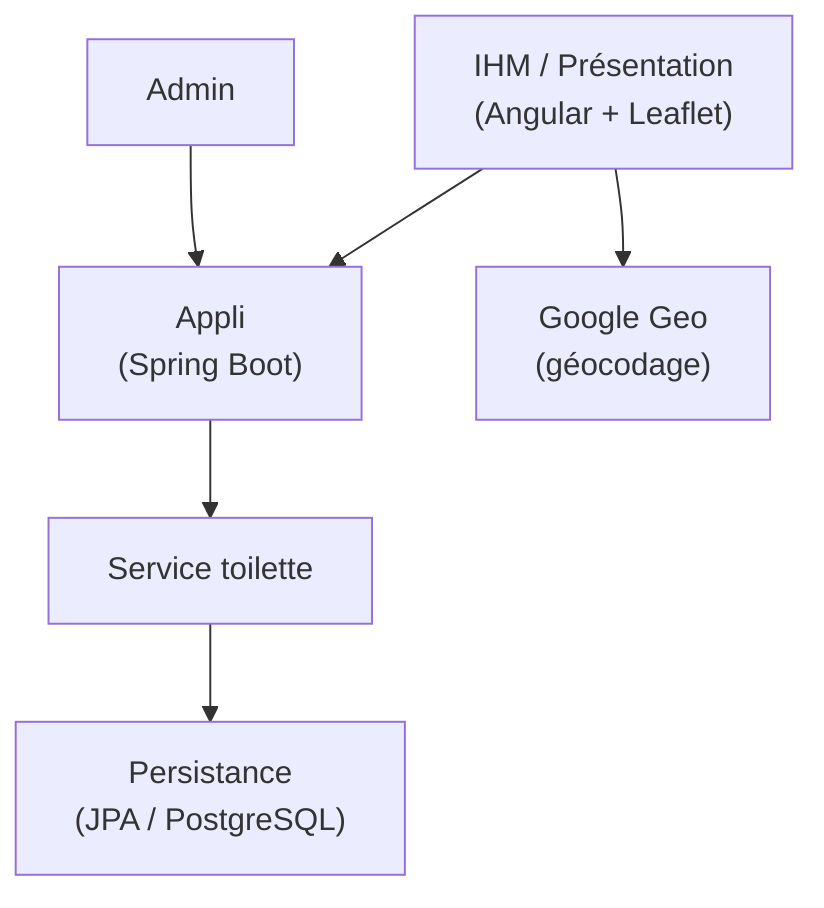
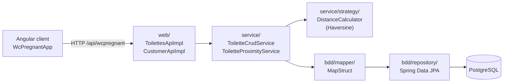
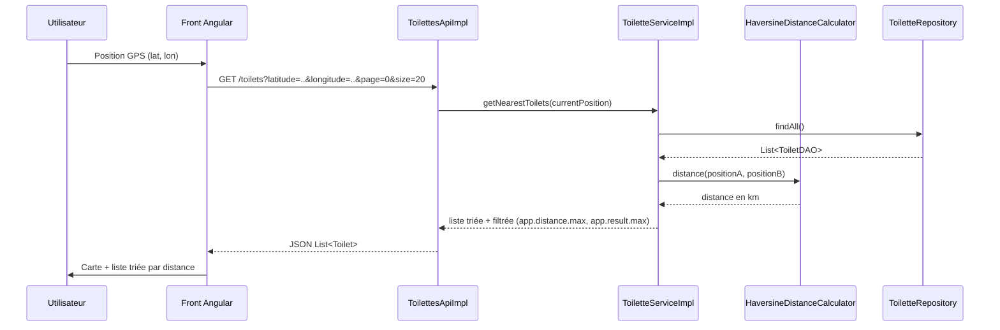
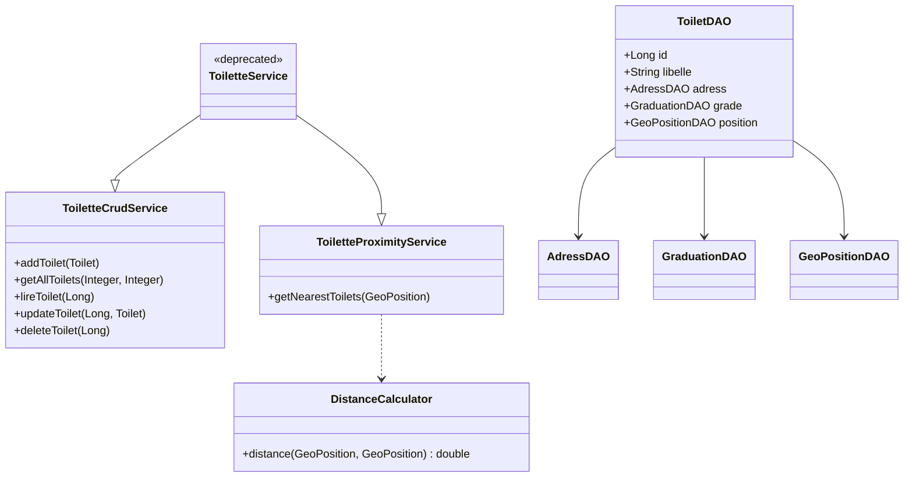
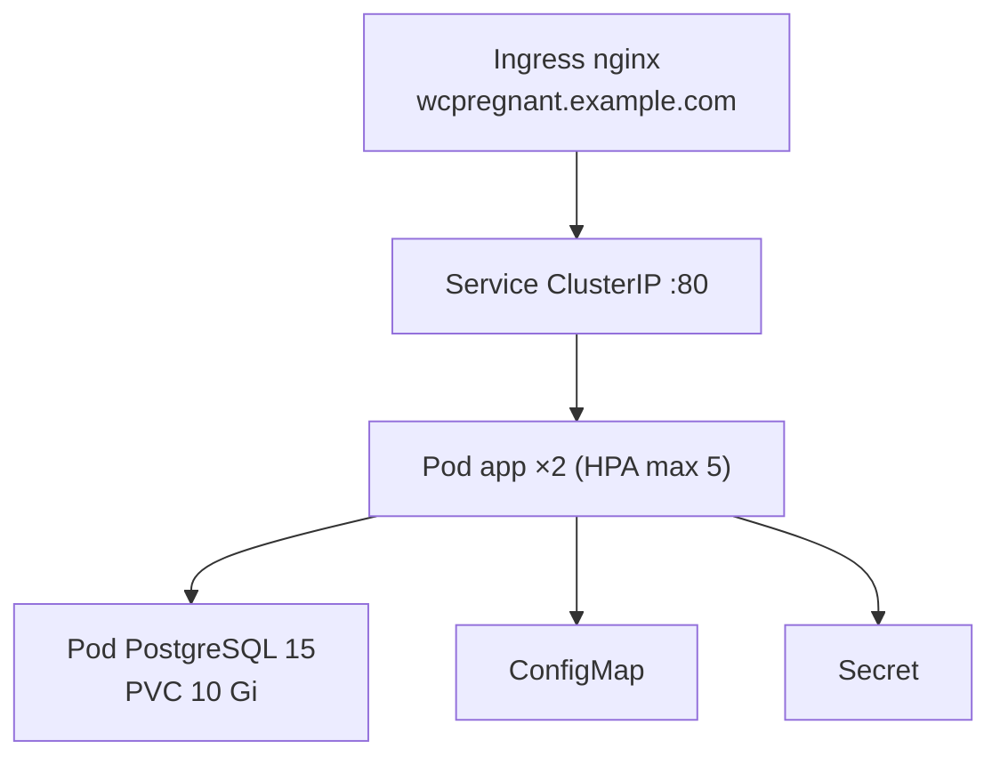

# Diagrammes d'architecture

> **Source** : [`assets/Diagrammes.pptx`](../assets/Diagrammes.pptx) — une seule diapositive contenant les étiquettes *présentation*, *IHM*, *Appli*, *Service*, *Service toilette*, *Persistance*, *admin*, *Google Geo*. Les diagrammes ci-dessous sont la **reconstruction Markdown** de cette esquisse, alignée sur le code réel.

---

## 1. Diagramme de composants (vue de l'esquisse d'origine)

> Le géocodage externe n'est **pas** branché dans l'implémentation actuelle : la position est saisie ou fournie par le client. La distance est calculée en interne par la stratégie `DistanceCalculator` (Haversine).

---

## 2. Architecture réelle en couches

---

## 3. Séquence : recherche de proximité

---

## 4. Diagramme de classes (noyau métier)

---

## 5. Déploiement cible

Détails : [kubernetes.md](../05-deploiement/kubernetes.md).
