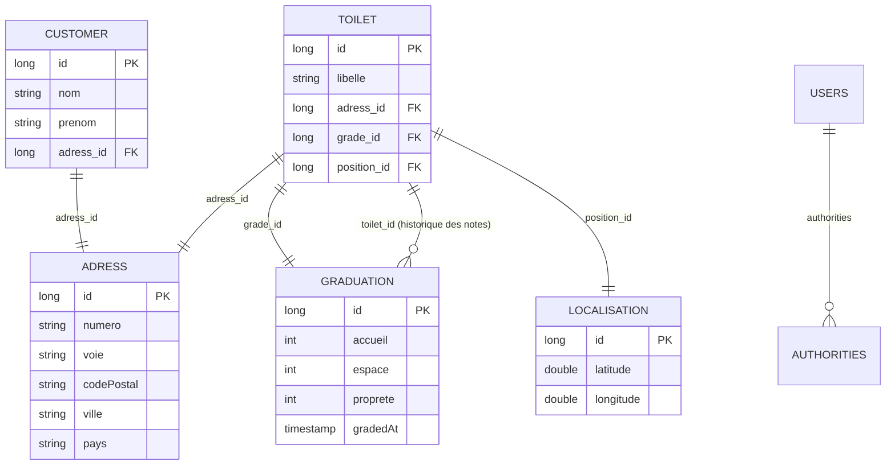

# Modèle de données

> **Sources** : entités JPA `WcPregnantService/src/main/java/org/manu/wcpregnant/bdd/dao/`, schémas [`ObjectDefinitions.yaml`](../../WcPregnantService/src/main/resources/api/ObjectDefinitions.yaml), et section *Business Object / Logical Services* du cahier des charges [`assets/DAL_WcPregnant_V1.0.docx`](../assets/DAL_WcPregnant_V1.0.docx).

---

## 1. Diagramme entité-relations

---

## 2. Tables

| Entité JPA | Table | Colonnes | Notes |
|---|---|---|---|
| `ToiletDAO` | `toilet` | `id`, `libelle`, `adress_id`, `grade_id`, `position_id` | `id` généré (`IDENTITY`) ; les 3 relations sont `@OneToOne(cascade = ALL, optional = false, orphanRemoval = true)` ; `graduationHistory` est un `@OneToMany(cascade = ALL)` vers `graduation` (`toilet_id`), trié `id DESC` |
| `AdressDAO` | `adress` | `id`, `numero`, `voie`, `codePostal`, `ville`, `pays` | Orthographe **`Adress`** côté backend : ne pas « corriger » |
| `GraduationDAO` | `graduation` | `id`, `accueil`, `espace`, `proprete`, `graded_at` | Notes 0-10 dans le contrat OpenAPI ; sert à la fois de note agrégée (`grade`) et d'entrée d'historique |
| `GeoPositionDAO` | `localisation` | `id`, `latitude`, `longitude` | Table nommée `localisation`, classe nommée `GeoPositionDAO` |
| `CustomerDAO` | `customer` | `id`, `nom`, `prenom`, `adress_id` | Lié à une adresse |
| `Users` | `users` | login, mot de passe haché | Authentification Spring Security |
| `Authorities` | `authorities` | rôle (`USER`, `ADMIN`) | RBAC |
| `UserAccount` | `user_account` | `id`, `login` (unique), `email`, `password` (**100**, haché), `resetCode` (**100**, haché), `resetCodeExpiresAt`, `createdAt`, `updatedAt` | Comptes du flux de **réinitialisation du mot de passe** ; table distincte de `users` pour éviter tout conflit de schéma |

**Conséquence des cascades** : supprimer une `toilet` supprime aussi son adresse, sa graduation et sa position (orphan removal).

### Réinitialisation du mot de passe

| Colonne | Contrainte | Raison |
|---|---|---|
| `password` | `length = 100` | un mot de passe BCrypt occupe 60 caractères ; le `PasswordEncoderFactories` ajoute le préfixe `{bcrypt}` → 67 caractères, marge de sécurité |
| `resetCode` | `length = 100` | le code à 6 chiffres est **haché en BCrypt** avant stockage : il n'est jamais persisté en clair |
| `resetCodeExpiresAt` | `Instant` | comparé à `Instant.now()` lors de la confirmation ; TTL `auth.reset.code-ttl-seconds` |
| `login` | `unique = true` | identifiant ou e-mail accepté à la demande de code |

Le code est **consommé** à la confirmation (`resetCode = null`, `resetCodeExpiresAt = null`) : un code ne peut être utilisé qu'une seule fois.

---

### Notation et historique des visites

| Élément | Comportement |
|---|---|
| `grade` (relation `grade_id`) | note **agrégée** affichée sur la fiche : moyenne des trois critères de toutes les entrées de `graduationHistory`, arrondie à l'entier le plus proche |
| `graduationHistory` | un `GraduationDAO` par visite, horodaté (`graded_at`), trié du plus récent au plus ancien |
| Bornage | chaque critère est ramené dans `[0, 10]` avant l'ajout à l'historique |
| Écriture | seule `ToiletteDAOMapper#gradeToilet` alimente l'historique ; le DTO `Toilet` expose l'historique en **lecture seule** (`boToDao` et `updateToiletteDAOFromBO` l'ignorent) |

---

## 3. Correspondance « objet métier du cahier des charges » → réalité

Le cahier des charges V1.0 définissait les objets métier ainsi :

| Objet métier (V1.0) | Attributs attendus | Réalisation actuelle | Écart |
|---|---|---|---|
| **Toilettes** | géolocalisation, adresse, propriétaire, prix, notation, diaporama | `ToiletDAO` : `libelle`, `adress`, `grade`, `position` | `propriétaire`, `prix` et `diaporama` (photos) non implémentés |
| **Utilisateur** | login, password, historique d'activités | `Users` (login/password) + `CustomerDAO` (nom, prénom, adresse) | Historique d'activités non implémenté |

---

## 4. Services logiques du cahier des charges → interfaces réelles

| Service logique (V1.0) | Signature attendue | Interface réelle |
|---|---|---|
| Services toilette | `Collection<Toilet> find(Position posIn)` | `ToiletteProximityService.getNearestToilets(GeoPosition)` |
| Services toilette | `void grade(Toilet wcToGradeIn)` | `ToiletteCrudService.updateToilet(Long, Toilet)` |
| Service register | `void register(User newUserIn)` | `CustomerService` (lecture seule) + `UserRepository` ; création non exposée |

---

## 5. Index recommandés (à créer)

Le cahier des charges mentionnait des **index géospatiaux**. Le schéma actuel n'a pas d'index explicites ; les pistes suivantes sont listées dans [architecture.md](architecture.md) :

| Index | Colonne(s) | Objectif |
|---|---|---|
| `idx_adress_code_postal` | `adress.codePostal` | Filtrage par code postal |
| `idx_localisation_lat_lon` | `localisation.latitude`, `localisation.longitude` | Recherche de proximité |
| `idx_toilet_libelle` | `toilet.libelle` | Recherche textuelle |
